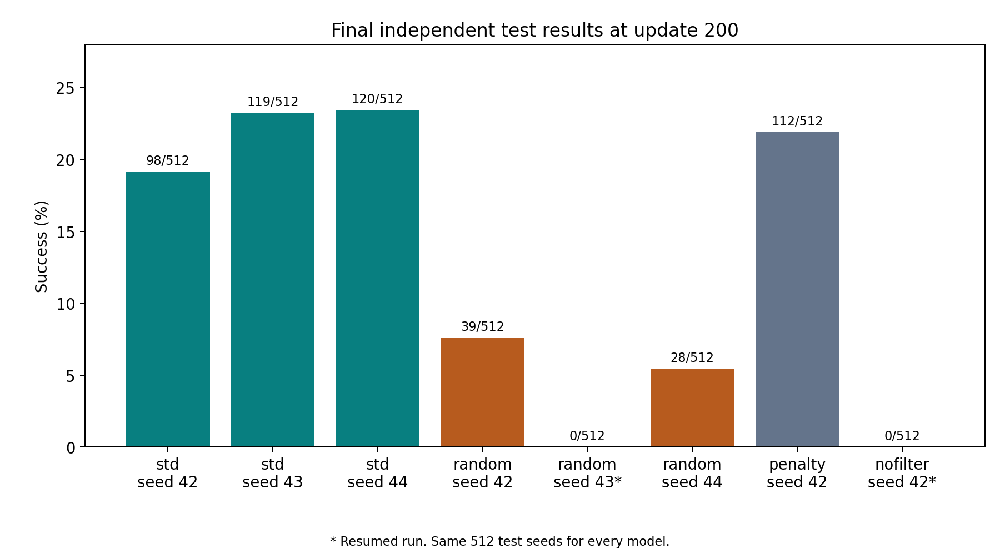
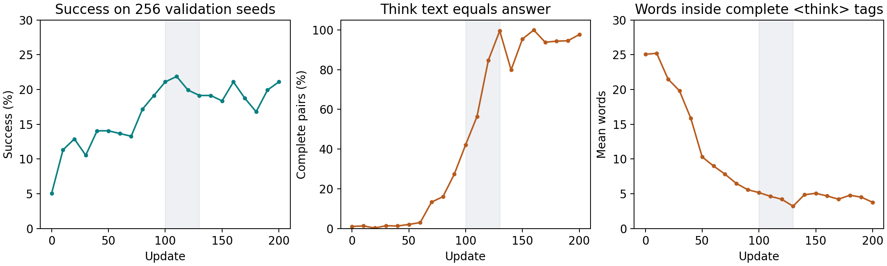
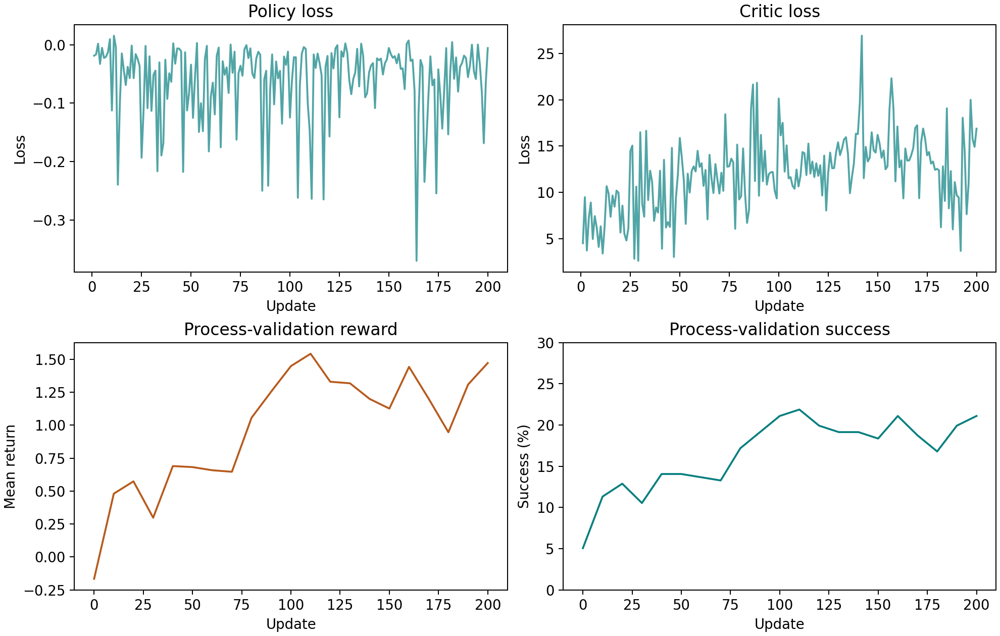

# RAGEN Sokoban Reproduction

A small, auditable reproduction and extension of **the first RAGEN paper (StarPO / StarPO-S)** using Qwen2.5-0.5B-Instruct on one H100. We train an LLM agent to solve text-based Sokoban puzzles, compare rollout-selection strategies, test a simple action penalty, and inspect the text inside its `<think>` tags.

**All eight models reached update 200.** This repository contains the experiment code, full recorded configurations, compressed raw metrics and trajectories, analysis scripts, and figures. No GPU is needed to reproduce the published tables and plots. Training new models requires a Linux CUDA machine.

This is a limited single-environment study, **not a full reproduction of the paper or RAGEN-2**. The standardized launcher and installation recipe were prepared after the experiments; their configuration logic and CPU analysis have been checked, but they have not been rerun end-to-end on a fresh GPU environment.

[Original RAGEN repository](https://github.com/RAGEN-AI/RAGEN) · [Paper](https://arxiv.org/abs/2504.20073) · [Training instructions](docs/reproduction.md) · [Experiment details](docs/experiments.md) · [Case studies](docs/case_studies.md)

## Main results

Each final model was evaluated once on the same **512 held-out environment seeds**, using the original reward with no added action penalty. The first two rows have three training seeds; the other rows have one. SD is the sample standard deviation across training seeds, in percentage points.

| Variant | Training seeds | Solved / 512 | Mean success |
| --- | --- | --- | --- |
| StarPO-S (`std`) | 42, 43, 44 | 98, 119, 120 | **21.94% ± 2.43 pp** |
| Random group filter | 42, 43, 44 | 39, 0*, 28 | 4.36% ± 3.93 pp |
| StarPO-S + ineffective-action penalty | 42 | 112 | 21.88% |
| No filter | 42 | 0* | 0.00% |

`*` Continued from a checkpoint: random seed 43 from update 191; no-filter seed 42 from update 133. The no-filter run trains on four times as many episodes per update, so it is **not compute matched**. These are descriptive results, not a statistical significance claim.



- **Rollout selection matters in these runs.** StarPO-S outperformed the random filter across the three tested seeds. A separate uninterrupted comparison through update 190 is included.
- **Better success did not preserve detailed written reasoning.** For the first run, mean words inside complete `<think>` tags fell from 25.07 to 3.79. Think/answer text equality rose from 1.12% to 97.62% on the validation set. This describes generated text, not hidden internal reasoning.
- **The penalty had mixed results.** It solved 112 test levels versus 98 for the same-seed standard run, but its ineffective-action fraction increased from 28.22% to 34.74%. One seed does not establish a robust improvement.
- **Two runs collapsed.** The final random-seed-43 and no-filter models produced no parsed actions on the held-out set. Their zero scores are retained in every summary.



## Recompute results locally — no GPU

```bash
git clone https://github.com/Kris-Liu773/ragen-sokoban-reproduction.git
cd ragen-sokoban-reproduction
python3 -m venv .venv-analysis
source .venv-analysis/bin/activate
python -m pip install -r requirements-analysis.txt
python scripts/analyze.py --verify
python scripts/plot.py
python -m unittest discover -s tests -v
```

`analyze.py` itself uses only the Python standard library. It verifies the compressed and uncompressed SHA-256 hashes, checks held-out seed coverage, merges the two resumed histories without double-counting the restart step, and recomputes the tables. Raw data is already in the clone: no external account, dataset download, or tracking service is required for analysis.

The default outputs are `results/final_results.csv`, `results/all_training_metrics.csv`, `results/test_thinking_diagnostics.csv`, `results/validation_thinking.csv`, `results/case_studies.json`, and `results/evidence.json`. Use `--out /path/to/new-results` to write elsewhere; then pass that directory to `plot.py`.

## Train a model

See [the full setup, smoke test, training, evaluation and resume instructions](docs/reproduction.md). After installing the GPU dependencies and downloading the pinned model:

```bash
python scripts/run.py smoke --run std_seed42 \
  --model models/Qwen2.5-0.5B-Instruct --out runs/smoke
python scripts/run.py train --run std_seed42 \
  --model models/Qwen2.5-0.5B-Instruct --out runs/std_seed42
python scripts/run.py evaluate --run std_seed42 \
  --model models/Qwen2.5-0.5B-Instruct --out runs/test_std_seed42 \
  --checkpoint runs/std_seed42/checkpoints/global_step_200
```

The smoke test starts a separate short run; the full training command starts fresh. Checkpoints and model weights are not in Git. Full actor and critic checkpoint components are required by this historical evaluation loader.

## What is included

| Directory | Purpose |
| --- | --- |
| `vendor/ragen/` | Runtime source used in the completed experiments, including pinned veRL and licenses |
| `configs/recorded/` | Eight full training configurations; machine-specific paths replaced with placeholders |
| `scripts/` | Portable training/resume/evaluation launcher, pinned model download, analysis and plotting |
| `slurm/` | One-GPU batch template; supply your own allocation and partition |
| `data/training/` | Original and resumed metric/trajectory logs, compressed without altering their contents |
| `data/evaluation/` | Ten evaluation records: eight final results and two earlier pre-continuation results |
| `results/` | Recomputed tables, curves, diagnostic evidence and selected cases |
| `provenance/` | Source/data checksums, upstream patch and recorded environment versions |
| `docs/` | Reproduction instructions, experiment definitions, case interpretation and limitations |



## Authors and acknowledgments

Yihao Tao, Bowu, Jintao Wang, Runhu, and Haotian Liu. Built on RAGEN and veRL; credit for StarPO and StarPO-S belongs to the original authors. See [third-party notices](THIRD_PARTY_NOTICES.md) and the [MIT license for our additions](LICENSE).
