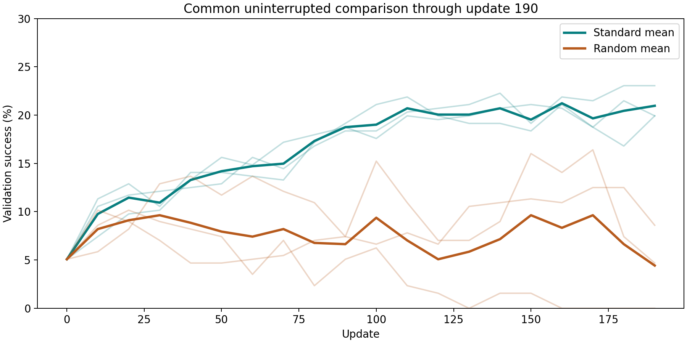

# Experiment definitions and history

## Task and training loop

The agent sees a text grid and emits reasoning text plus actions such as `<answer>Right || Down</answer>`. The environment executes the parsed actions and returns a new grid and reward. A full episode contains at most five model turns and ten executed actions. The board is 6 by 6 with one box; the task is to push the box onto the target.

The base model is Qwen2.5-0.5B-Instruct. Training uses the first RAGEN code line, full actor/critic fine-tuning with PPO and generalized advantage estimation, not a new implementation of the paper. Each update generates 16 full trajectories for each of eight initial states (128 episodes).

| Setting | Value |
| --- | --- |
| Target updates | 200 |
| Actor / critic learning rate | 1e-6 / 1e-5 |
| PPO mini-batch / GPU micro-batch | 32 / 4 |
| KL coefficient | 0 |
| Maximum response tokens per turn | 400 |
| Training / evaluation sampling temperature | 1.0 / 0.5 |
| Process-validation set | 256 environment seeds, 123–378 |
| Validation interval | Before training and every 10 updates, plus budget-stop evaluation |
| Held-out test set | 512 environment seeds, 2,000,000–2,000,511 |

See the recorded YAML files for the full settings, including clipping, entropy and environment reward configuration.

## Four variants

**StarPO-S (`std`)** keeps the two state groups with the largest standard deviation of trajectory rewards. All 16 episodes within each selected group are kept, giving 32 training episodes per update. This preserves groups whose outcomes differ across attempts.

**Random filter** keeps two randomly selected whole groups, also 32 episodes. This tests whether the selection criterion matters while keeping the number of selected episodes equal. Wall-clock time and generated token counts are not forced to match.

**Penalty** uses the same standard-deviation filter and adds −0.1 for each executed ineffective move during training. The extra penalty is off during validation and held-out evaluation. The goal was to discourage wasted moves; this was an exploratory modification, not an established improvement.

**No filter** trains on all 128 generated episodes. It changes both selection and update data volume, so it is a useful diagnostic but not a compute-matched ablation.

## Completed phases

| Phase | Actual allocation elapsed | Work completed |
| --- | --- | --- |
| Initial run | 51 min 05 sec | Short smoke test, then a fresh standard seed-42 run to update 200 |
| Follow-up suite | 7 hr 53 min 10 sec | Seven additional training runs; five reached 200, random seed 43 stopped at 191 and no-filter at 133 |
| Recovery / continuation | 1 hr 42 min 17 sec | Evaluated all eight available checkpoints, continued the two incomplete runs to 200, then reevaluated those two |

The second batch exited with an evaluation import error caused by a missing `ctx_manager.py`; training checkpoints remained available. The runtime source was restored before the recovery batch. The cause of the file's disappearance was not established. The recovery batch completed successfully. The missing-file issue was an execution problem; it does not explain away the zero-success models, which still generated no parsed actions after successful evaluation.

There are **eight main trained models, ten held-out evaluation records, and two continuations**. A continuation is not a new training seed. The earlier two evaluations are retained for audit, but final tables use only the eight update-200 models.

## Interpreting the results

At update 200, standard filtering achieved 21.94% mean held-out success versus 4.36% for random filtering across the three tested seeds. To separate this observation from the continuation issue, the repository also includes the common uninterrupted validation comparison at update 190: standard 20.96% ± 1.80 pp, random 4.43% ± 4.30 pp.

The no-filter and random-seed-43 runs ended with zero within-state reward standard deviation and no parsed actions in their final held-out trajectories. Their gradients increased markedly; detailed metrics are preserved. These observations are consistent with unstable training in these runs, but do not establish that one diagnostic caused the failure.

The penalty solved 112/512 held-out levels versus 98/512 for standard seed 42. However, it scored 52/256 versus 54/256 on process validation and had a larger ineffective-action fraction on the held-out set (1320/3800 versus 1254/4444). Report this as a mixed single-seed result. It does not justify claiming a reliable improvement or more efficient behavior.

Training duration alone is not evidence of experiment quality. The initial short run established a working framework and a useful reasoning-text observation. The longer follow-up added repeated seeds, comparison methods, failure diagnostics and held-out evaluation.
